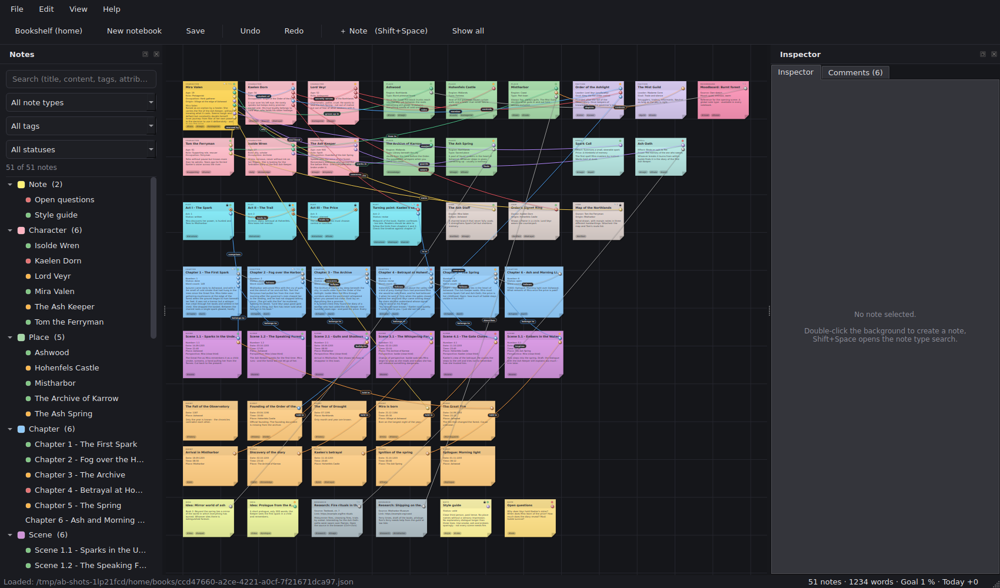
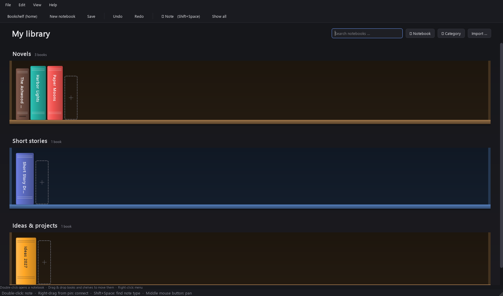
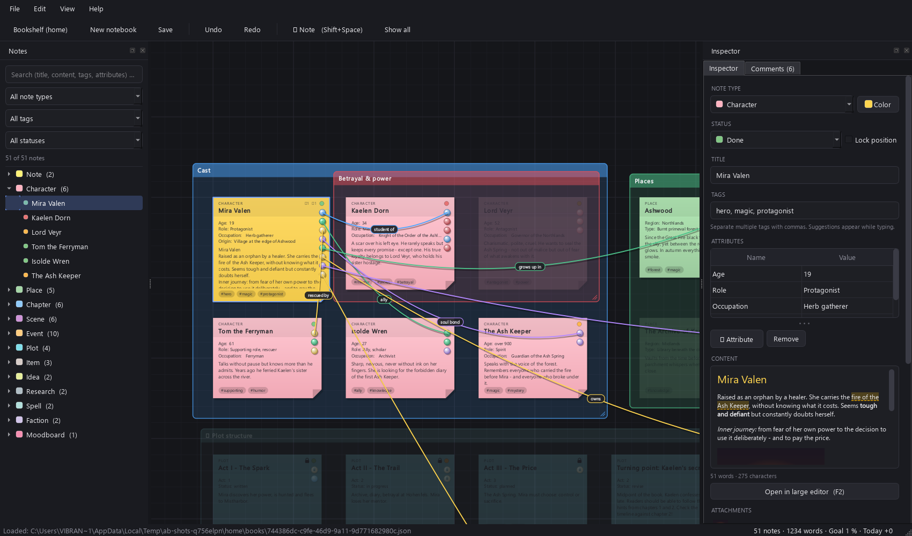
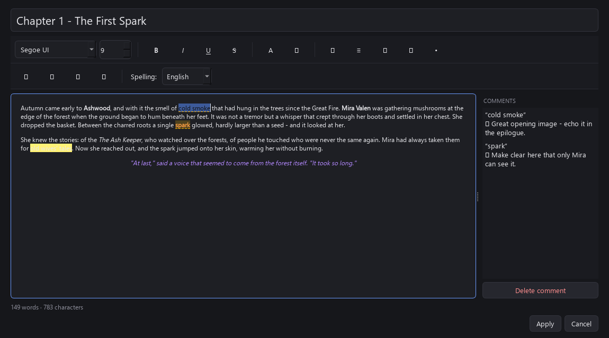
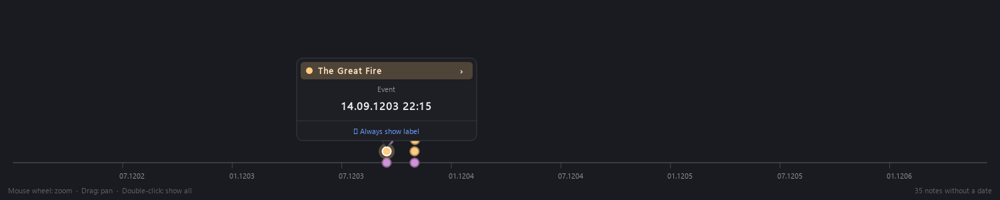
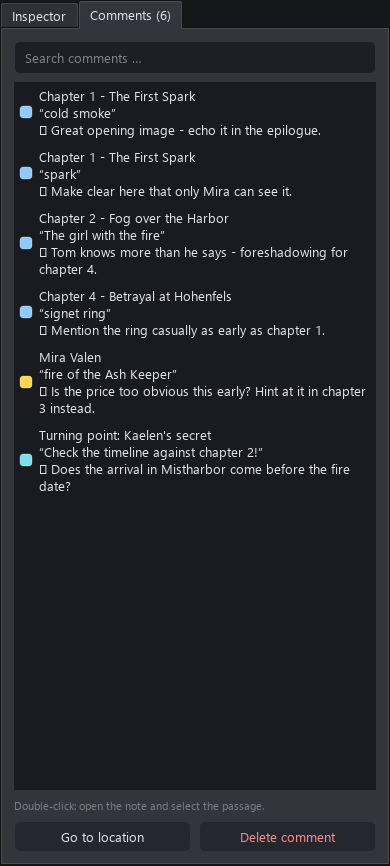
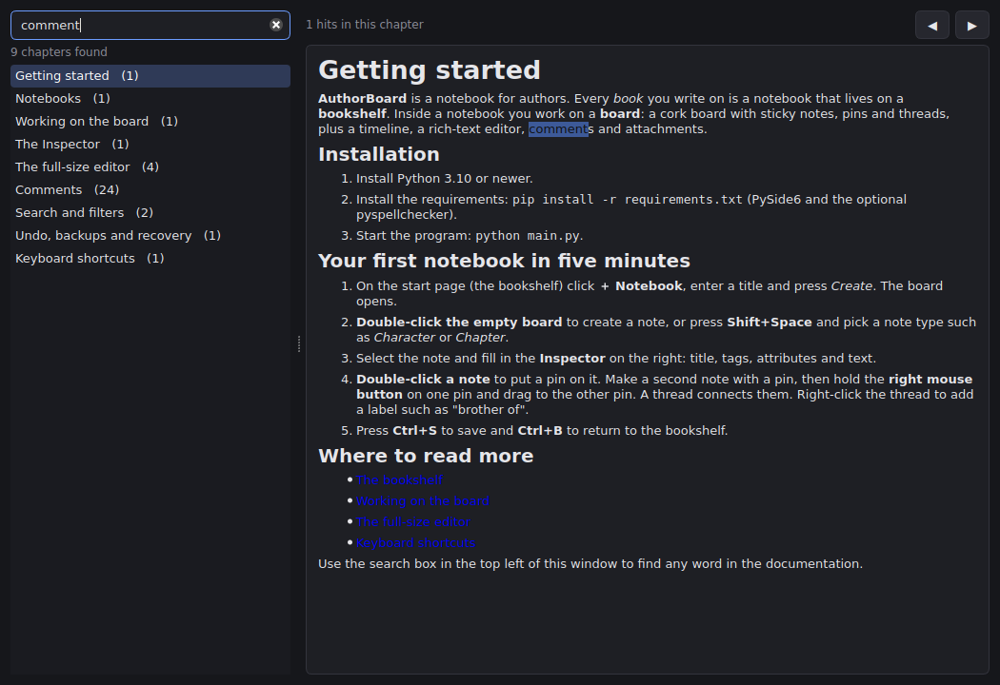

<p align="center">
  
</p>


<h1 align="center">AuthorBoard</h1>

<p align="center">
  <b>Notebooks for authors</b> - a bookshelf for your projects, a cork board with sticky notes, pins and threads,
  a timeline, a rich-text editor with comments, attachments and spell checking.
</p>

<p align="center">
  <a href="LICENSE"></a>
  
  
  
  
</p>

<p align="center">
  
</p>

---

## Contents

[Features](#features) · [Screenshots](#screenshots) · [Installation](#installation) · [Quick start](#quick-start) ·
[Showcase project](#showcase-project) · [Keyboard shortcuts](#keyboard-shortcuts) · [Languages](#languages) ·
[Where is my data?](#where-is-my-data) · [Project layout](#project-layout) · [Development](#development) ·
[Documentation](#documentation) · [License](#license) · [Disclaimer](#disclaimer)

## Features

**Organise your library**
- 📚 **Bookshelf start page** - every notebook is a book spine, grouped on named, colourable shelves. Drag books and whole shelves around; the spine gets thicker with your word count and shows a progress bar towards your word goal.
- 🗂 **Notebook information** - title, author, genre, category, colour, word goal, deadline, description and your own fields.

**Plot on a board**
- 🗒 **Sticky notes** with types (character, place, chapter, scene, event, plot, item, idea, research, ...), status dots, tags, free attributes and a content preview.
- 📌 **Pins and threads** - connect pins by dragging with the right mouse button; coloured, labelled threads ("brother of") run *in front* of the notes and fade where they cross a note.
- 🎚 **Adaptive thread visibility** - when zoomed out, threads are hidden by default to keep the board readable; select a note to reveal its connected threads. Threads connected to the selection stay visible and clickable at any zoom. On very large boards threads render as simple strokes.
- 🔒 **Locking** - lock notes so they stay in place; lock pins so they cannot be dragged inside a note but still follow it.
- 🎯 **Focus mode** - select a note and everything not connected to it is greyed out.
- 🔎 **Search & filters** - full text, `#tags`, note type, status; the board dims what does not match.
- 🧩 **Custom note types** - per notebook or global for all notebooks (Settings).
- 🏷 **Tag auto-completion** that remembers the tags of each book.
- 🚀 **Scales to large boards** - the renderer picks a level of detail per item from the current zoom and the number of visible notes, threads and pins, so panning and zooming stay responsive on boards with thousands of notes and threads.

**Write**
- ✍️ **Full-size rich-text editor** - fonts, bold / italic / underline / strike-through, text colour, highlighter, alignment, lists, **links that open in the web browser** (Ctrl+click) and **images**.
- 💬 **Comments** on words or sentences with a hover pop-up and a **Comments tab** that lists every comment. A single click in the tab selects and centres the note that holds the comment; a double click opens the editor and jumps to the commented words.
- 📎 **Attachments** - attach any file or image to a note; everything is stored inside the notebook file.
- ✅ **Spell checking** for **English and German** with suggestions and a user dictionary.

**See the story**
- 🕒 **Horizontal timeline** - dots in the colour of the note, information bubble on click, zoom and pan. Smooth on boards with thousands of dated notes.
- 📊 **Statistics** - words per note type, status, tags, longest and most connected notes, daily progress.

**Stay safe**
- ↩️ **Undo / redo** for everything, a **save prompt** for unsaved changes, **autosave** with crash recovery (written off the UI thread) and automatic **backups**.
- 📤 **Export** - manuscript (Markdown, text, HTML, **PDF**; HTML/PDF keep formatting and images), outline as Markdown, board as PNG.
- 🌍 **Two languages (English / Deutsch)** switchable at runtime and easy to extend.
- 📖 **Built-in searchable documentation** (F1).

## Screenshots

| | |
|---|---|
|  <br> *Bookshelf with colourable, draggable shelves* |  <br> *Focus mode: only the selection and its connections stay bright* |
|  <br> *Full-size editor with formatting and comments* |  <br> *Timeline with information bubble* |
|  <br> *Comments tab* |  <br> *Searchable documentation* |

## Installation

Requirements: **Python 3.10 or newer**.

```bash
git clone <your-repository-url> authorboard
cd authorboard

python -m venv venv
# Windows:  venv\Scripts\activate        macOS / Linux:  source venv/bin/activate

pip install -r requirements.txt
python main.py
```

`requirements.txt` contains **PySide6** (Qt 6) and the optional **pyspellchecker**. Without pyspellchecker everything works except the spell check.

## Quick start

1. On the bookshelf click **＋ Notebook**, give it a title and press *Create*.
2. **Double-click the board** to create a note - or press **Shift+Space** and pick a note type.
3. Fill in the **Inspector** (right): title, tags, attributes, text, attachments.
4. **Double-click a note** to add a pin. Hold the **right mouse button** on a pin and drag it onto another pin to connect them with a thread.
5. Press **F2** for the full-size editor. Select words, right-click → *Add comment …*.
6. **Ctrl+S** saves, **Ctrl+B** returns to the bookshelf, **F1** opens the documentation.

## Showcase project

The folder [`showcase/`](showcase) contains a fully filled example notebook (51 notes, 45 threads, rich text, comments, attachments, locks, custom types) in **English** and **German**:

- `The Ashwood Chronicles (Showcase).json`
- `Die Chroniken von Aschenwald (Showcase).json`

On the bookshelf click **Importieren … / Import …** and select the file. Book information (title, author, genre, word goal, ...) is imported as well. Regenerate the files with `python tools/make_showcase.py`.

## Keyboard shortcuts

| Shortcut | Action | Shortcut | Action |
|---|---|---|---|
| `Shift+Space` | Find note type / new note | `Ctrl+S` | Save |
| `Ctrl+B` | Back to bookshelf | `Ctrl+Z` / `Ctrl+Y` | Undo / redo |
| `Ctrl+N` | New notebook | `Ctrl+D` | Duplicate note |
| `F2` | Full-size editor | `Ctrl+L` | Lock / unlock note |
| `Ctrl+F` | Search | `Ctrl+0` / `Ctrl+1` | Show all / 100 % |
| `Ctrl+I` | Statistics | `Ctrl+,` | Settings |
| `F1` | Documentation | `Ctrl+K` (editor) | Insert link |
| `Ctrl+Alt+M` (editor) | Add comment | `F11` (editor) | Full screen |

Mouse: wheel = zoom, middle button = pan, right-drag pin → pin = thread, double-click board = note, double-click note = pin.

## Languages

English and German are included (*View → Language*, applied immediately). Adding a language takes minutes:

```bash
python i18n.py new fr "Français"   # creates locales/fr.json with every text
# translate the values in locales/fr.json, optionally copy help/en -> help/fr
python main.py                      # the language shows up in the menu
```

`python i18n.py update fr` adds texts that appeared later, `python i18n.py check fr` lists missing translations.

## Where is my data?

| What | Where |
|---|---|
| Library and shelves | `~/.authorboard/library.json` |
| Notebooks (one self-contained JSON file each, attachments included) | `~/.authorboard/books/` |
| Automatic backups | `~/.authorboard/backups/` |
| Settings, user dictionary, global note types | `~/.authorboard/settings.json` |

Set the environment variable `AUTHORBOARD_HOME` to use another folder. On Windows `~` is your user folder.

## Project layout

```text
main.py                 application entry point and MainWindow (controller)
canvas.py               BoardScene / BoardView: notes, pins, threads, focus mode
note_item.py pin_item.py connection_item.py   graphics items of the board
inspector.py            property editor of the selected note
rich_text.py            rich-text widget: images, links, comments, spell check
editor_dialog.py        full-size editor
comments_panel.py       comments list + Inspector/Comments tab widget
spellcheck.py           spell-check engine (pyspellchecker)
attachments.py          in-memory attachment store
shelf.py library.py     bookshelf page and library data
timeline.py             horizontal timeline widget
models.py storage.py    data classes and JSON file format
undo.py                 snapshot based undo / redo
settings.py settings_dialog.py   global settings and note types
help_dialog.py about_dialog.py   documentation and About windows
i18n.py locales/        translations (+ CLI tool)    help/   manual (en, de)
tools/                  showcase and screenshot generators
tests/                  headless test suite          docs/ mkdocs.yml   developer docs
```

## Development

```bash
pip install -r requirements.txt -r requirements-dev.txt
python tests/run_all.py          # headless test suite (Qt offscreen)
python tools/make_showcase.py    # regenerate showcase/*.json
python tools/make_screenshots.py # regenerate docs/images/*.png
mkdocs serve                     # developer documentation at http://127.0.0.1:8000
```

The code is commented and every module, class and function has a docstring. Start with the *Architecture* pages of the developer documentation (`docs/`), they explain how the pieces fit together and how to extend the program (new note types, export formats, languages, ...).

Contributions are welcome - see [CONTRIBUTING.md](CONTRIBUTING.md).

## Documentation

- **User manual**: inside the program (*Help → Documentation*, `F1`) - searchable, English and German. The sources are in [`help/`](help).
- **Developer documentation**: [`docs/`](docs), built with MkDocs (`mkdocs serve`).

## License

AuthorBoard is free software, released under the **GNU General Public License v3.0 or later** (`GPL-3.0-or-later`). See [LICENSE](LICENSE).

## Disclaimer

This software is provided **"as is"**, without warranty of any kind. Use it at your own risk. No responsibility or liability is accepted for any damage, loss of data, lost work or any other harm resulting from its use. **Please back up your work regularly.**

## Credits

AuthorBoard was made in an iterative collaboration between a human and two AI
assistants:

- **Concept, direction and oversight — *Vibrantic***
  Every feature, layout decision, bug report and performance target came from the
  human maintainer: what to build, what to keep, what to cut, and when a fix was
  good enough. Design decisions, UX testing, bug reproduction, performance
  profiling on real hardware, and final review of every change.

- **Initial implementation, architecture, user manual and showcase —
  *Claude***, an AI assistant made by [Anthropic](https://www.anthropic.com).
  Source code of the original 1.0 release, automated tests, developer
  documentation, translations, and the showcase project were written in an
  ongoing conversation with the maintainer, driven by their feedback at each step.

- **Performance work, LOD rendering, timeline rewrite, undo restructuring, and
  bug fixes — *DeepSeek***, an AI assistant made by
  [DeepSeek](https://www.deepseek.com). The performance overhaul (level-of-detail
  tiers for notes, threads and pins; viewport culling; off-thread autosave;
  structural-sharing undo snapshots; the O(N) timeline), the adaptive
  thread-visibility rules, the comment-click and focus-mode fixes, and the
  cursor-handling work were implemented in this codebase and reviewed by the
  maintainer at every step.

Built with [Python](https://www.python.org),
[Qt for Python (PySide6)](https://doc.qt.io/qtforpython/) and
[pyspellchecker](https://github.com/barrust/pyspellchecker).
