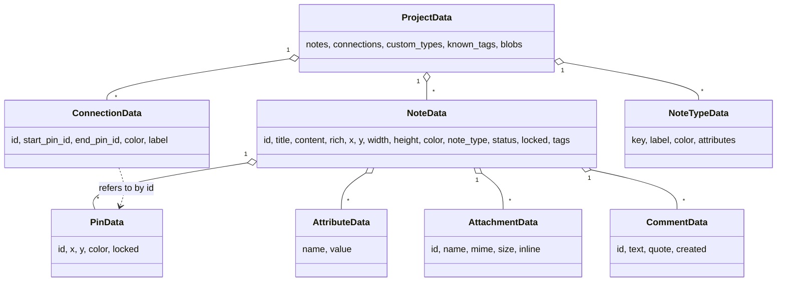

# Data model & file format

All classes live in `models.py` and are plain `@dataclass`es.



## Plain text vs rich text

A note keeps **two** representations of its text:

* `content` - always the **plain text**. Used by search, word counts, statistics, Markdown/text export.
* `rich` - the **HTML** produced by Qt, only when the text has formatting (bold, colours, links, images, comments ...). For plain notes it is `""`.

`rich_text.has_rich_content()` decides; `RichTextEdit.to_storage()` returns `(plain, rich_or_empty)`.

## Types of notes

`NoteData.note_type` is a *key*. The definitions (`NoteTypeData`) come from three sources, merged in `MainWindow.reset_types`:

| Source | Keys | Stored in |
|---|---|---|
| built-in (`BUILTIN_NOTE_TYPES`) | `note`, `character`, `location`, ... | code (labels translated with `builtin_note_types()`) |
| global | `global_*` | `settings.json`; copied into a notebook file when notes use them |
| book | `custom_*` | the notebook file (`custom_types`) |

## Attributes with special meaning

Attributes are free name/value pairs, but three names are recognised in **any language**
(`models.attribute_matches`): *Datum/Date* (timeline), *Uhrzeit/Time* and *Nummer/Number* (manuscript order).
To teach the program another language's word, add it to `_ATTR_SYNONYMS` or translate the canonical German name in the locale file (the code also compares against `tr("Datum")`).

## Attachments

`AttachmentData` is only metadata. The bytes live in `AttachmentStore.blobs` (in memory) and are
written into the file as base64 (`attachment_data`), **only those still referenced**
(`AttachmentStore.referenced_ids`). Undo snapshots contain no bytes.

## File format (version 4)

```json
{
  "version": 4,
  "custom_types": [{"key": "custom_spell", "label": "Spell", "color": "#b2dfdb", "attributes": ["Effect"]}],
  "known_tags": ["hero", "magic"],
  "notes": [{
      "id": "...", "title": "...", "content": "plain text", "rich": "<html>...</html>",
      "x": 0.0, "y": 0.0, "width": 270, "height": 200, "color": "#ffb3c1",
      "note_type": "character", "status": "done", "locked": false, "tags": ["hero"],
      "attributes": [{"name": "Age", "value": "19"}],
      "pins": [{"id": "...", "x": 252, "y": 38, "color": "#4da6ff", "locked": false}],
      "attachments": [{"id": "...", "name": "map.png", "mime": "image/png", "size": 1234, "inline": false}],
      "comments": [{"id": "ab12cd34ef56", "text": "...", "quote": "...", "created": "2026-10-01T10:15"}]
  }],
  "connections": [{"id": "...", "start_pin_id": "...", "end_pin_id": "...", "color": "#d4a373", "label": "brother of"}],
  "attachment_data": {"<attachment id>": "<base64>"},
  "book": {"title": "...", "author": "...", "...": "optional, only read by the shelf importer"}
}
```

* `Storage.from_dict` uses `.get(..., default)` everywhere, so **older files (versions 1-3) load** and missing fields get defaults.
* `Storage.save` writes to `<file>.tmp` and renames (`os.replace`) - a crash never leaves a half-written file.
* The optional `"book"` object is **not** part of a board; the shelf importer (`Library.apply_meta`) reads it to create the book's metadata.
