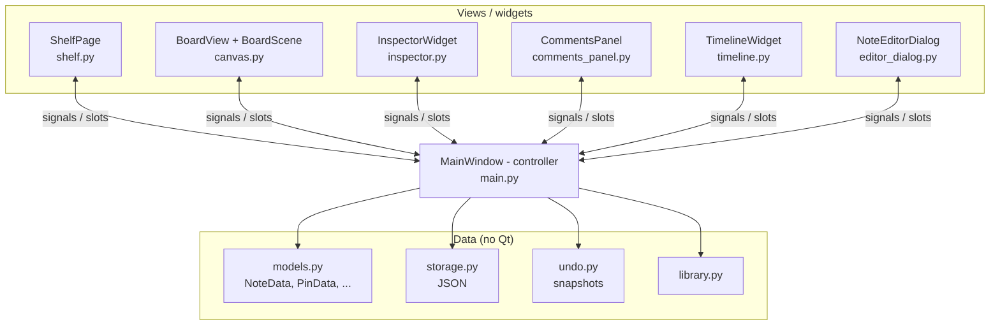

# Architecture overview

## Layers



* **Views** only display data and report user actions through Qt *signals*.
* **`MainWindow`** is the single controller: it connects signals, owns the application state and decides what happens next (save, refresh, undo checkpoint ...).
* **Data classes** are plain dataclasses. The *same* `NoteData` object is referenced by its `NoteItem` on the board and edited by the inspector - there is no copying, so a change is visible everywhere immediately.

## The central idea: items wrap models

```text
NoteData (models.py)  <----- note.model -----  NoteItem (QGraphicsItem on the board)
   |  title, content, rich, tags,                    |  paints the sticky note,
   |  attributes, pins, attachments, comments        |  owns PinItem children
```

The inspector edits `note.model` and then calls `note.update()` (repaint) and emits `note_modified`.
`MainWindow` reacts by **debouncing** two jobs:

1. `schedule_refresh` -> `refresh_views` (tree, tag combo, stats, timeline, comments tab ...)
2. `schedule_checkpoint` -> `checkpoint` (push an undo snapshot, update the dirty flag)

## Signal map

| Signal | Emitted by | Handled in `MainWindow` |
|---|---|---|
| `notes_changed` | `BoardScene` | `schedule_refresh`, `schedule_checkpoint` |
| `interaction_finished` | `BoardScene` (mouse released) | `schedule_checkpoint` |
| `note_selected(note)` | `BoardScene` | `on_note_selected` -> inspector |
| `note_modified(note)` | `InspectorWidget` | refresh + checkpoint |
| `edit_requested(note)` | scene / inspector | `open_editor` |
| `open_requested(note, id)` | `CommentsPanel` | `open_editor(..., focus_comment)` |
| `open_requested(book)` | `ShelfPage` | `open_book` |

## Two "modes"

The central widget is a `QStackedWidget` with the **bookshelf** and the **board**.
`apply_mode()` enables/disables actions and `_hide_docks()` / `_restore_docks()` show the side docks only on the board.
`show_shelf()` always goes through `maybe_save()` so unsaved work is never lost silently.

## Threads of control

There is **one thread**. Timers (`QTimer`) are used for debouncing (refresh 120 ms, checkpoint 350 ms), autosave (minutes) and deferred rebuilds (`QTimer.singleShot(0, ...)`) when an item must not be destroyed inside its own event handler.
